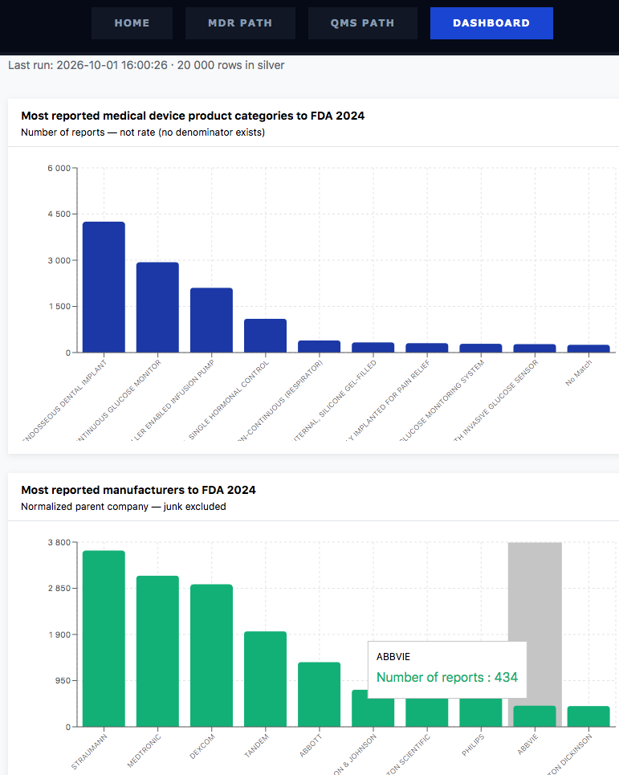

This document covers the data analysis behind the [Aegis Compliance](./README.md) dashboard. 
**Live demo:** [mdr-qms-steps.vercel.app](https://mdr-qms-steps.vercel.app/)
 

 

### STEP 1 - DEFINE THE RESEARCH QUESTION 
The purpose is to answer
| #  | Question | 
|---|---|
| Q1 | Which products have the most device reports in 2024? |
| Q2 | Which manufacturers have the most device reports in 2024? |
 
 
 
### STEP 2 - EXPLORE AVAILABLE FILES FROM THE DATABASE 
See [FDA's MAUDE database](https://www.fda.gov/medical-devices/medical-device-reporting-mdr-how-report-medical-device-problems/mdr-data-files#download)
 
| Available Files | Description | 
|---|---|
| mdrfoi*.zip | Master data: Summary of all data files, event types, reporters |
| patientthru*.zip | Patient data: Information related to the patient(s) involved |
| foitext*.zip | Text data: Textual information from MEDWATCH |
| device*.txt | Device data: Information related to the device(s) involved |
 
- All are strings and pipeline delimited. 
- Device data will be used in this analysis. 
 
 
#### 2.1 SELECT DATA FIELDS
 
| Column Headers | Description | 
|---|---|
| `MDR_REPORT_KEY` | Links this file to other MAUDE files. Can be duplicated.| 
| `DEVICE_SEQUENCE_NO`| Unique per unit in a report|
| `GENERIC_NAME`  | The generic common name of the medical device | 
| `DEVICE_REPORT_PRODUCT_CODE` | FDA product classification code (3 letters) | 
| `MANUFACTURER_D_NAME` | Company that manufactured the device | 
 
 
#### 2.2 EXPLORATORY DATA ANALYSIS (EDA) TO DISCOVER REQUIREMENTS
 
```bash 
python medallion/analysis/eda_device.py
```

SUMMARY (for details, see [medallion/analysis/eda_device_output.txt](./medallion/analysis/eda_device_output.txt))
```
 === 1. Duplicates on primary key ===
rows: 2,629,410
unique MDR_REPORT_KEY: 2,627,121
unique DEVICE_SEQUENCE_NO: 2,629,373
duplicated (MDR_REPORT_KEY, DEVICE_SEQUENCE_NO): 33
duplicated (the whole row): 31
```
```
=== 2. Missing values (%) ===
MDR_REPORT_KEY: 0.00 | DEVICE_SEQUENCE_NO: 0.00 | GENERIC_NAME: 0.02 | MANUFACTURER_D_NAME: 0.16 | DEVICE_REPORT_PRODUCT_CODE: 0.00 | 
```
```
=== 3. Junk MANUFACTURER_D_NAME = ===
junk list: 1,065 | shorter than 2 chars: 15

Short MANUFACTURER_D_NAME 
MPRI: 34885 | UNK: 537 | BD: 113 | 0HP: 21 | SERF: 18 | .: 12 | 000: 5 | DSS: 3 | BIOS: 3
```
```
=== 4. Variants of MANUFACTURER_D_NAME ===
OLYMPUS: 43 spellings, 55,957 rows
MEDTRONIC: 99 spellings, 274,262 rows
ALCON: 20 spellings, 11,719 rows
BOSTON SCIENTIFIC: 27 spellings, 64,829 rows
ABBOTT: 95 spellings, 90,271 rows
```
```
=== 5. One PRODUCT_CODE, several GENERIC_NAMES? ===
codes: 2,206 | codes with more than 1 name: 1,402
```
```
=== 6. Concentration of PRODUCT_CODE'S (COUNTS) ===
DZE: 697107 | QBJ: 347156 | QFG: 273207 | OZP: 129596 | BZD: 68264 | FRN: 57739
top 30 codes = 77.7% of rows
top 20 manufacturers = 68.3% of rows
```

#### DATA LIMITATIONS
- Under-reporting of events
- Inaccuracies in reports
- Lack of verification that the device caused the reported event
- Lack of information about frequency of device use
- Nr of reports will be high where there are many products on the market, this is not "risk"

#### 2.3 - ANALYSIS METHOD
Count reports per product code (Q1) and per parent manufacturer (Q2), ranked by count. Junk and NULL manufacturers are excluded from Q2.
 
