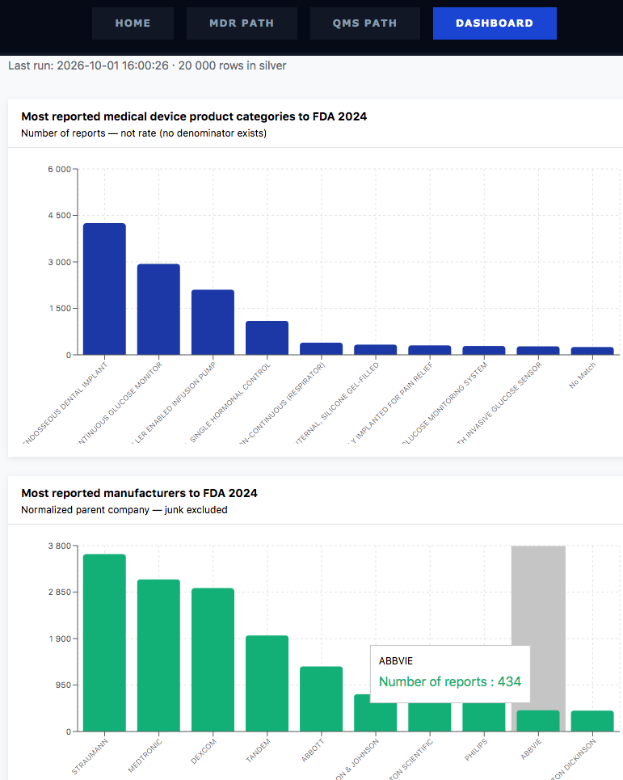

# PIPELINE.md — ETL Pipeline: Medallion Architecture
This document covers the process behind the [Aegis Compliance](./README.md) dashboard. 
**Live demo:** [mdr-qms-steps.vercel.app](https://mdr-qms-steps.vercel.app/)
 

 
This documentation contains 
- I - STEPS IN CONDUCTING THE ANALYSIS &
- II - STEPS IN CONDUCTING THE PIPELINE

  
## I - STEPS IN CONDUCTING THE ANALYSIS
### STEP 1 - DEFINE THE RESEARCH QUESTION 
The purpose is to answer
| #  | Question | 
|---|---|
| Q1 | Which products have the most device reports in 2024? |
| Q2 | Which manufacturers have the most device reports in 2024? |
 
 
 
### STEP 2 - EXPLORE AVAILABLE FILES FROM THE DATABASE 
See [FDA's MAUDE database](https://www.fda.gov/medical-devices/medical-device-reporting-mdr-how-report-medical-device-problems/mdr-data-files#download)
 
| Available Files | Description | 
|---|---|
| mdrfoi*.zip | Master data: Summary of all data files, event types, reporters |
| patientthru*.zip | Patient data: Information related to the patient(s) involved |
| foitext*.zip | Text data: Textual information from MEDWATCH |
| device*.txt | Device data: Information related to the device(s) involved |
 
- All are strings and pipeline delimited. 
- Device data will be used in this analysis. 
 
 
#### 2.1 SELECT DATA FIELDS
 
| Column Headers | Description | 
|---|---|
| `MDR_REPORT_KEY` | Links this file to other MAUDE files. Can be duplicated.| 
| `DEVICE_SEQUENCE_NO`| Unique per unit in a report|
| `GENERIC_NAME`  | The generic common name of the medical device | 
| `DEVICE_REPORT_PRODUCT_CODE` | FDA product classification code (3 letters) | 
| `MANUFACTURER_D_NAME` | Company that manufactured the device | 
 
 
#### 2.2 EXPLORATORY DATA ANALYSIS (EDA) TO DISCOVER REQUIREMENTS
 
```bash 
python medallion/analysis/eda_device.py
```

SUMMARY (for details, see medallion/analysis/eda_device.txt )

```
 === 1. Duplicates on primary key ===
rows: 2,629,410
unique MDR_REPORT_KEY: 2,627,121
unique DEVICE_SEQUENCE_NO: 2,629,373
duplicated (MDR_REPORT_KEY, DEVICE_SEQUENCE_NO): 33
duplicated (the whole row): 31
```
```
=== 2. Missing values (%) ===
MDR_REPORT_KEY: 0.00 | DEVICE_SEQUENCE_NO: 0.00 | GENERIC_NAME: 0.02 | MANUFACTURER_D_NAME: 0.16 | DEVICE_REPORT_PRODUCT_CODE: 0.00
```
```
=== 3. Junk MANUFACTURER_D_NAME = ===
junk list: 1,065 | shorter than 2 chars: 15

Short MANUFACTURER_D_NAME 
MPRI: 34885 | UNK: 537 | BD: 113 | 0HP: 21 | SERF: 18 | .: 12 | 000: 5 | DSS: 3 | BIOS: 3
```
```
=== 4. Variants of MANUFACTURER_D_NAME ===
OLYMPUS: 43 spellings, 55,957 rows
MEDTRONIC: 99 spellings, 274,262 rows
ALCON: 20 spellings, 11,719 rows
BOSTON SCIENTIFIC: 27 spellings, 64,829 rows
ABBOTT: 95 spellings, 90,271 rows
```
```
=== 5. One PRODUCT_CODE, several GENERIC_NAMES? ===
codes: 2,206 | codes with more than 1 name: 1,402
```
```
=== 6. Concentration of PRODUCT_CODE'S (COUNTS) ===
DZE: 697107 | QBJ: 347156 | QFG: 273207 | OZP: 129596 | BZD: 68264 | FRN: 57739
top 30 codes = 77.7% of rows
top 20 manufacturers = 68.3% of rows
```

#### DATA LIMITATIONS
- Under-reporting of events
- Inaccuracies in reports
- Lack of verification that the device caused the reported event
- Lack of information about frequency of device use
- Nr of reports will be high where there are many products on the market, this is not risk


#### 2.3 - ANALYSIS METHOD
Aggregation + ranking, since categorical and numerical data types
 
 
 
## II - STEPS IN CONDUCTING THE PIPELINE

 
### Pipeline Architecture & Data Flow
```
 DEVICE2024.txt
      │  bronze_ingest.py
      ▼
 ┌────────────┐
 │  BRONZE    │  
 └─────┬──────┘
       │  Gate keeper tests before SILVER
       ▼
 ┌────────────┐   
 │  SILVER    │──────────────► silver_rejected 
 └─────┬──────┘
       │  Gate keeper tests before GOLD 
       ▼
 ┌────────────┐
 │  GOLD      │  
 └─────┬──────┘
       │  Gate keeper tests before Dashboard  
       ▼
   run_pipeline() logs the run in pipeline_runs
       │  
       ▼  
 ┌────────────┐
 │  SUPABASE  │  
 └─────┬──────┘
       ▼
  Dashboard + Data quality panel      
```
 
### STEP 1 - REQUIREMENTS ON EACH LAYER  


- One requirement = one test = one ID. Gatekeeper tests (GK) come last in each layer.
- The next layer is built only if all gatekeeper tests of the previous layer pass.

#### Bronze

| ID | Requirement | Why | Test |
|---|---|---|---|
| B1 | Read pipe-delimited `latin-1`, quotes as plain text | Wrong encoding corrupts manufacturer names | `test_B1_latin1_names` |
| B2 | A changed source header fails loudly | FDA can change the file format; a wrong mapping must not load silently | `test_B2_missing_column_fails` |
| B3 | Malformed lines are counted and logged, never hidden | No silent data loss | `test_B3_bad_lines_counted` |
| B4 | Values are stored raw: text only, leading zeros and junk markers (`N/A`) kept; only an empty field becomes `NULL` | Bronze is the untouched source of truth | `test_B4_values_stored_raw` |
| B5 | Every row is traceable to file and line | Any number on the dashboard can be traced back to the source | `test_B5_traceable_rows` |
| B6 | A rerun adds nothing | Idempotent ingest: safe to run again | `test_B6_rerun_adds_nothing` |
| B7 | Bronze is append-only | Raw data can never be changed after load | `03_bronze.sql` (manual) |
| **GKB1** | Every source column is mapped | Catches a wrong file or mapping on real data | `03_bronze.sql` (manual) |

#### Silver

| ID | Requirement | Why | Test |
|---|---|---|---|
| S1 | Invalid rows are quarantined with a reason, never dropped | EDA: 33 duplicate keys | `verify_pipeline()` `S1` |
| S2 | Missing name or manufacturer: `NULL` + flag, never imputed | EDA: 0.16 % missing manufacturer | `verify_pipeline()` `S2` |
| S3 | Junk manufacturer names are flagged and kept | EDA: 1,065 junk names (`UNK`, `NI`, …) | `verify_pipeline()` `S3` |
| S4 | Manufacturer names map to the correct parent company | EDA: up to 99 spellings per manufacturer; protects Q2 | `verify_pipeline()` `S4` |
| S5 | Each product code has one canonical name | EDA: 1,402 codes with more than one name; protects Q1 | `verify_pipeline()` `S5` |
| **GKS1** | Reconciliation: bronze = silver + quarantine | Proves no row was lost between layers | `verify_pipeline()` `GKS1` |

#### Gold

| ID | Requirement | Why | Test |
|---|---|---|---|
| G1 | Every run is logged; the latest run succeeded | The dashboard shows only data from a successful run | `verify_pipeline()` `G1` |
| G2 | The public `anon` role cannot read raw data | Least privilege: only gold is public | `verify_pipeline()` `G2` |
| **GKG1** | Reconciliation: products | Protects the answer to Q1 | `verify_pipeline()` `GKG1` |
| **GKG2** | Reconciliation: manufacturers, junk and `NULL` excluded | Protects the answer to Q2 | `verify_pipeline()` `GKG2` |

#### Observability
| ID | Requirement | Test |
|---|---|---|
|O1| Ingest progress, skipped lines, rows per second, duration | `bronze_ingest.py` log |
|O2| One row per pipeline run (counts, status, error) | `pipeline_runs` |
|O3| Result of every verification check at publish | `quality_checks` |
|O4| Rows per layer, % valid rows (threshold 95 %), checks passed | Dashboard: `DataQualityPanel.jsx` |
 

### STEP 2 — RUN THE PIPELINE

FILE STRUCTURE

```
├── PIPELINE.md
├── ingest.log
├── medallion
│   ├── analysis
│   │   ├── eda_device.py
│   │   └── eda_device_output.txt
│   ├── python
│   │   ├── bronze_ingest.py
│   │   ├── requirements.txt
│   │   └── test_bronze_ingest.py
│   ├── scripts
│   │   ├── db_run.sh
│   │   └── db_setup.sh
│   ├── sql
│   │   ├── 01_create_tables.sql
│   │   ├── 02_seed_manufacturers.sql
│   │   ├── 03_bronze.sql
│   │   ├── 04_silver.sql
│   │   ├── 05_gold.sql
│   │   ├── 06_pipeline.sql
│   │   └── 07_verify_silver_gold.sql
│   └── supabase.js
├── src
│   ├── components
│   │   ├── Dashboard.jsx
│   │   ├── DataQualityPanel.jsx
```


Note: MAUDE data is public and contains no personal data. For other sources, hash sensitive columns, e.g. encode(digest(col, 'sha256'), 'hex').